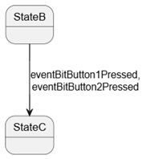
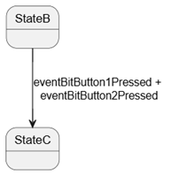
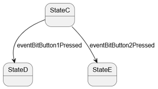
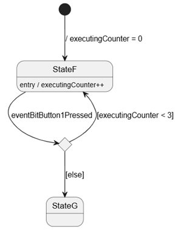
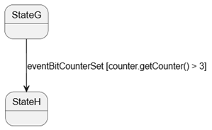

# Beschrijving

In dit template worden verschillende manieren gedemondstreerd hoe van de ene staat naar de andere staat gegaan kan worden.   
De hulpklassen button en counter hebben misleidende namen. Button is een "nep" taak die om de zoveel tijd op de ene en dan op de andere knop drukt (dit simuleert hij).  
Counter overschrijft een oplopende waarde in de queue van zijn klasse. De queue heeft een grootte van 1. **Dit is anders dan bij het vorige template! Daar was MachineControl eigenaar van de queue.** In dit template demonstreren we de get functionaliteit.    

Hieronder de versimpelde std's van de overgangen (de entry / events zijn in het merendeel van de diagrammen weggelaten):
Je kan meteen naar een demo gaan van een specifieke overgang door de startstaat aan te passen in de initalizer list van de constructor.

- Als een van de knoppen wordt ingedrukt:  

- Als de beide knoppen moeten zijn ingedrukt:  

- Als verschillende knoppen tot verschillende resultaten leiden:  

- Als een staat meerdere keren moet worden uitgevoerd:  

- Als een extra conditie geldt voor de overgang:  
