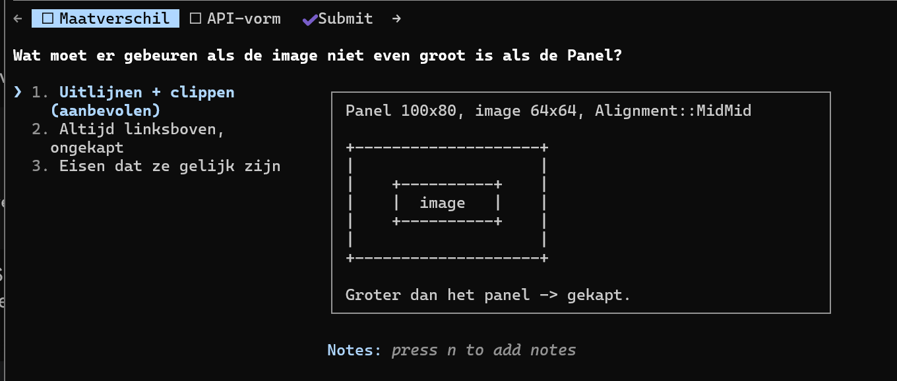

# CYD speed research

Potentiele verbeteringen:

- HSPI port naar gpio verbinden
- snellere SPI clock
- DMA activeren (voorkomt dat esp wacht tot spi transactie klaar is voordat hij verder gaat).

## HSPI port.

                                                                                                            ┌───────────────┬──────┬──────┐

  │      tak      │ MOSI │ SCLK │
  ├───────────────┼──────┼──────┤
  │ USE_HSPI_PORT │ 13   │ 14   │
  ├───────────────┼──────┼──────┤
  │ VSPI (huidig) │ 23   │ 18   │
  └───────────────┴──────┴──────┘

  De HSPI-defaults zijn precies jouw CYD-pinnen. Dat is geen toeval: 12/13/14/15 zijn de IOMUX-pinnen van HSPI op de
  ESP32. De CYD-ontwerper heeft de display bewust op HSPI's native pinnen gelegd.                                                                                                                                                                 Elke SPI-peripheral heeft een set pinnen waarmee hij rechtstreeks verbonden kan worden, buiten de GPIO-matrix om.
  Gebruik je die native pinnen met de bijbehorende controller, dan gaat het signaal direct — minder                       propagatievertraging, betere signaalintegriteit, en daardoor een hogere haalbare klok. Gebruik je ze met de andere      controller, dan moet alles alsnog door de matrix.                                                                                                                                                                                               Dat is wat er nu gebeurt: je draait de display op VSPI, terwijl de bedrading voor HSPI is ontworpen. Het wérkt prima —  de matrix routeert het netjes — maar je laat de directe route liggen.                                                                                                                                                                           Dus                                                                                                                                                                                                                                             #define USE_HSPI_PORT
                                                                                                                          verandert niets aan je bedrading en niets aan je pinconfiguratie. Het zegt alleen: gebruik de controller waar dit
  bordje voor bedoeld is. Vrijwel alle CYD-voorbeeldsetups die je online vindt hebben deze define er dan ook in staan.                                                                                                                            Eén ding om op te letten: de touch-XPT2046 op 32/33/25/39 hangt aan de andere poort. Als die na de omzetting stopt met  werken, zitten ze elkaar in de weg — maar met deze pinverdeling is dat onwaarschijnlijk, want ze delen geen enkele      lijn.                                                  

# Image files embedden op zodanige manier dat die snel te blitten zijn

  Dat kan via EMBED_FILES. 
   Dat is de nettere variant voor échte imagebestanden: in main/CMakeLists.txt geef je bij idf_component_register(...)
  het pad naar een binair bestand op:
  idf_component_register(SRCS "main.cpp" ...
                         EMBED_FILES "assets/player.rgb565")
  De build embedt het bestand dan letterlijk in de binary en je krijgt linker-symbolen:
  extern const uint8_t player_start[] asm("_binary_player_rgb565_start");
  extern const uint8_t player_end[]   asm("_binary_player_rgb565_end");
  Zelfde eindresultaat als de C-array (bytes in flash, gelezen via de cache), maar zonder een megagroot gegenereerd
  headerbestand — je converteert de PNG éénmalig naar raw RGB565 en de CMake-regel doet de rest.

## Plan van claude:

   Here is Claude's plan:
╌╌╌╌╌╌╌╌╌╌╌╌╌╌╌╌╌╌╌╌╌╌╌╌╌╌╌╌╌╌╌╌╌╌╌╌╌╌╌╌╌╌╌╌╌╌╌╌╌╌╌╌╌╌╌╌╌╌╌╌╌╌╌╌╌╌╌╌╌╌╌╌╌╌╌╌╌╌╌╌╌╌╌╌╌╌╌╌╌╌╌╌╌╌╌╌╌╌╌╌╌╌╌╌╌╌╌╌╌╌╌╌╌╌╌╌╌╌╌╌
 Image-assets in flash zonder CMakeLists-wijzigingen

 Context

 Marius wil image-bestanden als flash-assets gebruiken in zijn apps. Zijn workflow:
 alle apps worden gestart door in main/main.cpp de juiste #include <App.ino> te
 uncommenten; de CMakeLists blijft daarbij altijd hetzelfde. EMBED_FILES zou per
 asset een CMakeLists-regel vergen én embedt álle assets van álle apps altijd —
 past niet bij die workflow.

 De oplossing: het patroon dat al bewezen is met main/flash_asset.h —
 een gegenereerde header met een const uint16_t-array. const → .rodata →
 memory-mapped uit flash via de cache (gemeten: 161 MB/s, 2–4% langzamer dan RAM,
 voorkopiëren zinloos). Voordelen boven EMBED_FILES:

- Nul CMake-wijzigingen, nu en per toekomstige asset.

- Alleen de assets die de actieve app #includet komen in de binary;
  assets van uitgecommentarieerde apps kosten niets.

- Een asset reist mee met de app-directory (bijv.
  libs/CleanGUI_for_TFT_eSPI/examples/Inputfield/assets/); een quoted
  #include "assets/naam.h" in de .ino resolvet relatief aan het .ino-bestand,
  dus ook dat vergt geen include-dir-regels.
  
  Wat er gebouwd wordt
1. Converter-tool: tools/img2rgb565.py
   
   Python-script (Pillow) dat elk door Pillow leesbaar beeld (PNG/JPG/BMP/GIF)
   omzet naar een header, in de stijl van main/flash_asset.h:
   
   python3 tools/img2rgb565.py speler.png            # -> speler.h naast de bron
   python3 tools/img2rgb565.py speler.png -o pad/x.h # expliciet doel
   python3 tools/img2rgb565.py speler.png --name heldSprite
   python3 tools/img2rgb565.py speler.png --transparent "#FF00FF"
   
   Gegenereerde header bevat:
- #pragma once, #include <stdint.h>

- #define <NAAM>_W / <NAAM>_H

- bij --transparent: #define <NAAM>_TRANSP 0x.... (kleursleutel voor de
  transp-parameter van pushImage)

- const uint16_t <naam>[W*H] = { ... }; — RGB565, zelfde waarde-conventie als
  flashAsset (gewone uint16-waarden; tft.setSwapBytes(true) bij direct naar
  TFT pushen, sprites regelen het zelf via pushImage)

- commentaarkop met bronbestand + aanroep waarmee hij gegenereerd is
  (reproduceerbaarheid), en de gebruiks-snippet.
  
  Details:

- RGB888→RGB565 met afronding; alpha-kanaal: pixels met alpha < 128 krijgen de
  transparantkleur (alleen zinvol met --transparent, anders waarschuwing).

- 12 waarden per regel, zoals flash_asset.h.

- Faalt netjes met melding als Pillow ontbreekt (pip install Pillow).
2. Voorbeeldasset + gebruiksdemo
- Een klein testbeeld (bijv. 48x48, door het script zelf gegenereerd of een
  simpel PNG'tje) converteren naar
  libs/CleanGUI_for_TFT_eSPI/examples/Inputfield/assets/testlogo.h
  als werkend voorbeeld van het patroon "asset naast de app".
- In Inputfield.ino géén gedragswijziging; alleen als commentaarblok de
  twee regels tonen die nodig zouden zijn (include + pushImage), zodat het
  voorbeeld geen visuele verrassing introduceert. (De echte integratie in een
  app is een aparte, bewuste stap.)
3. Logboek
   
   Nieuwe entry bovenaan devdocs/Claude_log/Claude_log.md (## 2026-07-24 — ...):
   waarom geen EMBED_FILES, het header-patroon, de tool-aanroep, en de
   meetfeiten waar dit op leunt (flash-blit ~gratis; DMA kan niet uit flash lezen —
   voor pushImageDMA eerst naar een DRAM-sprite blitten, en dat schrijven vereist
   double buffering).
   
   Bestanden
- nieuw tools/img2rgb565.py

- nieuw libs/CleanGUI_for_TFT_eSPI/examples/Inputfield/assets/testlogo.h (gegenereerd)

- edit libs/CleanGUI_for_TFT_eSPI/examples/Inputfield/Inputfield.ino (alleen commentaar-snippet)

- edit devdocs/Claude_log/Claude_log.md

- Géén wijzigingen aan main/CMakeLists.txt of main/main.cpp.
  
  Verificatie
1. Tool draaien op een testbeeld; header visueel controleren (afmetingen, eerste
   pixels handmatig narekenen tegen bekende kleuren).
2. Tijdelijk de include + een pushImage-aanroep activeren, idf.py build —
   moet schoon compileren; daarna snippet weer terug naar commentaar.
   (Flashen/monitoren op /dev/ttyUSB0 kan desgewenst als extra check dat het
   beeld correct rendert.)
3. idf.py build in eindtoestand: byte-identiek gedrag van de app.

 Nieuw plan van claude:
  Plan: tools/img2rgb565.py — asset-converter met kleursleutel-transparantie

 Context

 Het project heeft nu één handgegenereerde asset-header (main/flash_asset.h, 64x64
 RGB565 in .rodata) die als benchmark-instrumentatie is ontstaan. Om echte
 game-assets te kunnen gebruiken is een converter nodig die willekeurige
 afbeeldingen omzet naar diezelfde headervorm. Bij het bespreken daarvan kwamen twee
 vragen op: welke defaults krijgen de opties, en wat kost transparantie op de CYD?

 Het antwoord op de tweede vraag stuurt het ontwerp: de ILI9341 kent geen
 transparantie, dus TFT_eSPI doet het in software met een run-detectie-lus die per
 transparant gat een setWindow() + pushPixels() uitvoert
 (libs/TFT_eSPI/TFT_eSPI.cpp:1480-1530). In het slechtste geval (afwisselend wel/niet
 transparant, bv. een geditherde rand) is dat één SPI-adresvenster per pixel —
 precies het pad dat volgens CLAUDE.md 581 ns/pixel kost in plaats van 12,4 ns/pixel.
 Daarom is de converter niet alleen een pixel-omzetter: hij moet zó uitvoeren dat het
 runtime-pad snel blijft.

 Extra vondst: TFT_eSprite::pushImage (libs/TFT_eSPI/Extensions/Sprite.h:118-119)
 heeft géén transp-overload. Een flash-asset kan dus niet direct met kleursleutel
 in een sprite geblit worden; alleen pushToSprite() (sprite→sprite,
 Extensions/Sprite.cpp:755) en TFT_eSPI::pushImage(..., transp) (sprite/flash→TFT)
 kennen transparantie. Dat gat vullen we met een kleine eigen blit-helper.

 Deel 1 — tools/img2rgb565.py

 Python 3 + Pillow, geen andere afhankelijkheden. Uitvoer volgt de stijl van
 main/flash_asset.h: #pragma once, #define <NAME>_W/_H, const uint16_t <name>[],
 12 waarden per regel.

 Opties en defaults| Optie | Default | Toelichting |
| :--- | :--- | :--- |
| `<input>` | — | verplicht; alles wat Pillow leest (PNG/JPG/BMP/GIF) |
| `-o, --output` | `<bron>` met .h-extensie, naast de bron | |
| `--name` | bestandsnaam-stem, tot C-identifier gesaneerd (mijn-speler.png → mijn_speler) | macro's worden MIJN_SPELER_W etc. |
| `--bpp` | 16 | 8 = RGB332 (halveert flash, verliest kleur) |
| `--transparent` | uit | zonder de vlag komt er geen kleursleutel |
| `(--transparent zonder waarde)` | `#FF00FF` | magenta, de klassieke sleutel |
| `--alpha-threshold` | 128 | alpha < drempel → sleutelkleur; alleen zinvol mét --transparent |
| `--matte` | `#000000` | achtergrond waarop semi-transparante pixels worden gecomposit |
| `--swap-bytes` | uit | uitvoer is host-volgorde uint16_t, dus app doet tft.setSwapBytes(true) |
| `--resize` | geen | `--resize 32x32, Lanczos` |
| `--dither` | uit | Floyd–Steinberg bij het kwantiseren naar 565 |
| `--columns` | 12 | waarden per regel, gelijk aan flash_asset.h |
| `--no-const` | uit (dus const) | const → .rodata → flash; zonder → DRAM, wat we niet hebben |

 Gedrag dat we expliciet regelen

1. Kwantisatie: (r>>3)<<11 | (g>>2)<<5 | (b>>3), truncatie (wat de ILI9341
   verwacht). --dither alleen voor verlopen.

2. Sleutelbotsing: na kwantisatie kan een echte kleur toevallig gelijk worden aan
   de sleutel. Die pixels krijgen +1 op het laagste groene bit, en het script meldt
   hoeveel er zijn genudged.

3. Emitteren van de sleutel: met transparantie komt er een
   #define <NAME>_TRANSPARENT 0xF81F in de header, zodat de app-code de constante
   niet hoeft over te typen.

4. Rapport op stdout: afmetingen, bytes, percentage transparante pixels, en het
   maximum aantal runs per beeldregel — dat getal voorspelt direct de SPI-kosten
   (zie deel 2). Bij > 4 runs per regel een waarschuwing.
   
   Zonder --transparent gedraagt het script zich als een pure omzetter, en is de
   uitvoer één blok dat met pushImage/pushSprite als bulk gaat.
   
   Deel 2 — kleine runtime-helper voor transparant bliten in een sprite
   
   Omdat TFT_eSprite::pushImage geen transp-variant heeft, komt er een header
   main/blit_keyed.h (of naast de GUI-laag, als daar een betere plek is) met één functie:
   
   void blitKeyed(TFT_eSprite& dst, int x, int y,
   
               int w, int h, const uint16_t* src, uint16_t key);
   
   Die schrijft runs van niet-sleutelpixels rechtstreeks met memcpy in de
   sprite-buffer. Kosten zijn geheugenbandbreedte, geen SPI. De sprite gaat daarna in
   één opake pushSprite() naar het scherm — het bulkpad van 12,4 ns/pixel.
   
   Dat is het aanbevolen patroon: transparantie in RAM oplossen, opaak naar de bus.
   tft.pushImage(..., transp) direct naar het scherm blijft beschikbaar maar is alleen
   verstandig voor kleine sprites met weinig gaten per regel.
   
   Deel 3 — meten (optioneel, maar goedkoop)
   
   main/spi_benchmark.h heeft al het meetraamwerk (benchFlashToSprite,
   benchSmallSprites). Eén extra functie die dezelfde asset drie keer tekent — opaak
   pushImage, pushImage(..., transp), en blitKeyed + opake pushSprite — geeft de
   harde getallen voor het logboek in plaats van schattingen.
   
   Bestanden
- nieuw tools/img2rgb565.py

- nieuw main/blit_keyed.h

- nieuw tools/README.md (kort gebruik + de defaults-tabel)

- evt. main/spi_benchmark.h — één benchmarkfunctie erbij

- evt. devdocs/Claude_log/Claude_log.md — entry bovenaan met de meetresultaten
  
  Verificatie
1. python3 tools/img2rgb565.py main/testasset.png op een testbeeld → header
   compileert mee in idf.py build.
2. Roundtrip-controle in het script zelf (--verify): decodeer de gegenereerde
   header terug naar een PNG en vergelijk visueel/statistisch met de bron.
3. Asset met alpha-rand converteren mét --transparent, de gerapporteerde runs/regel
   controleren, dan flashen naar /dev/ttyUSB0 en op het scherm kijken of de rand
   schoon is (geen magenta fringe → --alpha-threshold goed gekozen).
4. Benchmark draaien en de drie paden vergelijken; getallen in het logboek.
   ╌╌╌╌╌╌╌╌╌╌╌╌╌╌╌╌╌╌╌╌╌╌╌╌╌╌╌╌╌╌╌╌╌╌╌╌╌╌╌╌╌╌╌╌╌╌╌╌╌╌╌╌╌╌╌╌╌╌╌╌╌╌╌╌╌╌╌╌╌╌╌╌╌╌╌╌╌╌╌╌

Verder:

❯ waar ik naartoe wil, is rechtstreeks 16bpp blitten uit dat const geheugen, zonder buffer. Of, als er transparantie in het spel
  is, de delen met transparante pixels per pixel versturen en de overige delen als blok. Ik wil dat de Panel van CleanGUI een
  image bij constructie kan meekrijgen. In dat geval tekent als hij zichzelf tekent, niet een rectangle van een kleur, maar blit
  hij die image. CleanGUI is display-adapter independent en moet dat blijven. de ILI afhankelijke code voor het blitten van de
  image hoort thuis in crt_TFT_eSPI_DisplayAdapter.h. Ik weet niet of het meerwaarde heeft om TFT sprites daarvoor te gebruiken:
  onze eigen CleanGUI en displayadapter biedt al de benodigde tekenfuncties (toch?). Kun je hier feedback op leveren en/of met
  een plan komen?

Goede richting — en het antwoord op je kernvraag is: nee, je hebt geen TFT-sprites nodig. TFT_eSPI heeft al precies wat je
  beschrijft.

  Wat er al ligt

  TFT_eSPI::pushImage(x, y, w, h, const uint16_t* data) (TFT_eSPI.cpp:1450) blit rechtstreeks uit .rodata, geen sprite, nul extra
  RAM. En de transp-overload (TFT_eSPI.cpp:1480) doet letterlijk jouw twee-modus-idee: per beeldregel runs van niet-transparante
  pixels verzamelen, en die als blok wegschrijven met één setWindow() + pushPixels() per run. Een sprite ertussen zetten zou
  alleen maar een kopie en 2·w·h bytes DRAM toevoegen.

  Twee dingen die ik onderweg vond en die het ontwerp scherper maken:

  De const-overload is nét niet de snelste. Regel 1450 kopieert eerst regel voor regel naar een stack-lijnbuffer en pusht dán. De
  non-const overload (TFT_eSPI.cpp:1361) pusht een ongekapt beeld in één pushPixels(data, w*h) — nul kopieën, rechtstreeks van
  flash de SPI-FIFO in. Die splitsing bestaat voor AVR, waar PROGMEM een aparte adresruimte is; op de ESP32 is flash
  memory-mapped en gewoon leesbaar, en pushPixels leest alleen. Een const_cast in de adapter is hier dus veilig en levert de
  echte bufferloze weg op.

  Byte-volgorde kost niets. Ik had zelf verwacht dat dit uitmaakte, maar pushSwapBytePixels (Processors/TFT_eSPI_ESP32.c:288)
  draait de bytes om terwijl de vorige 512-bits transfer nog loopt: 16 shuffles tegen 12,8 µs bustijd. Volledig verstopt. Houd de
  header dus in host-volgorde en zet setSwapBytes(true) — wel netjes terugzetten, want het is globale state op _tft.

  Architectuurvoorstel

  CleanGUI blijft adapter-onafhankelijk door de image als ondoorzichtige handle te behandelen, niet als iets waar het in kan
  kijken:

  enum class PixelFormat : uint8_t { RGB565 = 0 };
  struct Image {
      const void* pData;
      int32_t     width, height;
      PixelFormat format;
      bool        bHasTransparency;
      uint32_t    transparentColor;   // ARGB, zelfde conventie als de rest van CleanGUI
  };

  CleanGUI raakt de pixels nooit aan; de format-tag laat een andere adapter weigeren of converteren. Dat is dezelfde afspraak die
  er al is voor uint32_t color: CleanGUI in ARGB, colTo16bit() in de adapter. Een abstracte IImage met getPixel() zou hier
  fataal zijn — dat maakt elke pixel virtueel.

  IDisplayDraw krijgt er één functie bij: drawImage(const Vec2& topLeftPix, const Image&). Drie implementors moeten mee, en dat
  is de complete lijst: TFT_eSPI_DisplayAdapter, AsyncDisplay, en DisplayCommand (die krijgt drawImage=15 plus één const
  Image*-veld; de lifetime-afspraak is dezelfde als bij str, en voor const statics in flash automatisch waar).

  Eén detail dat je in showPanel() niet moet doen: bij een transparante image niet eerst fillRect(_colBg). Dan verdubbel je het
  busverkeer én verlies je juist de doorkijk naar wat de ouder eronder heeft getekend.

  Twee dingen wil ik van je weten voordat ik het uitschrijf:

