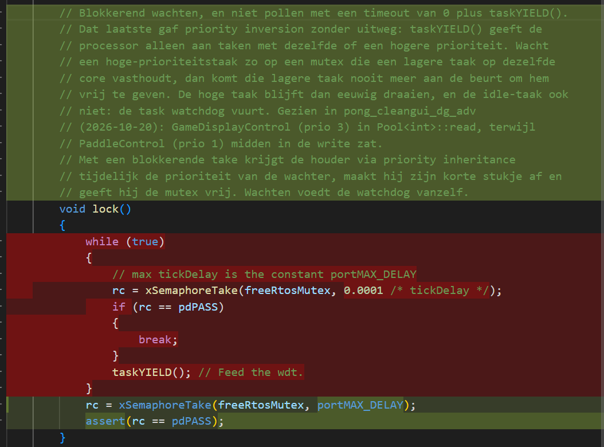

# Crash

```bash
Backtrace: 0x40084CF2:0x3FFB1860 0x4008330D:0x3FFB1880 0x400880DC:0x3FFCF9F0 0x400E96E5:0x3FFCFA10 0x4010C695:0x3FFCFBE0
--- 0x40084cf2: esp_crosscore_isr at /home/marius/esp54/esp-idf/components/esp_system/crosscore_int.c:73
--- 0x4008330d: _xt_lowint1 at /home/marius/esp54/esp-idf/components/xtensa/xtensa_vectors.S:1240
--- 0x400880dc: _frxt_dispatch at /home/marius/esp54/esp-idf/components/freertos/FreeRTOS-Kernel/portable/xtensa/portasm.S:484
--- 0x400e96e5: crt::SimpleMutex::lock() at /home/marius/dev/esp54/test_lasergame_2_rework_CleanGUI_godmode/libs/CleanRTOS/src/internals/crt_SimpleMutex.h:38
--- (inlined by) crt::Pool<int>::read(int&) at /home/marius/dev/esp54/test_lasergame_2_rework_CleanGUI_godmode/libs/CleanRTOS/src/crt_Pool.h:35
--- (inlined by) pong_cleangui_dg_adv::GameDisplayControl::syncPaddlePanelPos() at /home/marius/dev/esp54/test_lasergame_2_rework_CleanGUI_godmode/apps/pong_cleangui_dg_adv/pdga_GameDisplayControl.h:766
--- (inlined by) pong_cleangui_dg_adv::GameDisplayControl::redrawWholePage(crt::PageRoot<73u>&) at /home/marius/dev/esp54/test_lasergame_2_rework_CleanGUI_godmode/apps/pong_cleangui_dg_adv/pdga_GameDisplayControl.h:815
--- (inlined by) pong_cleangui_dg_adv::GameDisplayControl::main() at /home/marius/dev/esp54/test_lasergame_2_rework_CleanGUI_godmode/apps/pong_cleangui_dg_adv/pdga_GameDisplayControl.h:1068
--- 0x4010c695: crt::Task::staticMain(void*) at /home/marius/dev/esp54/test_lasergame_2_rework_CleanGUI_godmode/libs/CleanRTOS/src/crt_Task.h:109

E (55494) task_wdt: Task watchdog got triggered. The following tasks/users did not reset the watchdog in time:
E (55494) task_wdt:  - IDLE1 (CPU 1)
E (55494) task_wdt: Tasks currently running:
E (55494) task_wdt: CPU 0: IDLE0
E (55494) task_wdt: CPU 1: GameDisplayCont
E (55494) task_wdt: Print CPU 1 backtrace
```

Remedie, in CleanRTOS, crt_SimpleMutex:


