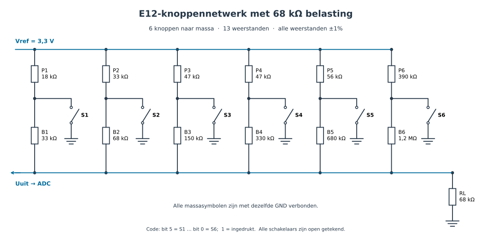

# ADC_buttons_E12

Zes drukknoppen uitlezen via één ADC-pin van de CYD (ESP32-2432S028R), met een
weerstandsladder van twaalf E12-weerstanden (±1%). Elke combinatie van ingedrukte
knoppen (64 in totaal) geeft een eigen spanning. `crt::ADC_buttons_E12` meet die
spanning in een eigen CleanRTOS-taak en meldt `buttonPressed` / `buttonReleased`
aan zijn listeners.

Bestanden, in `libs/CYD_tools_crt/src/ADC_buttons_E12/`:

| Bestand | Inhoud |
|---|---|
| `crt_ADC_buttons_E12.h` | De klasse (header-only, template op het maximale aantal listeners). |
| `crt_IADC_buttons_E12.h` | Interface: `addButtonListener`, `isButtonPressed`, `getPressedMask`, `getMillivolts`. |
| `crt_IADC_buttons_E12Listener.h` | Listener-interface: `buttonPressed(int)`, `buttonReleased(int)`. |
| `crt_ADC_buttons_E12_ladder.h` | De weerstandswaarden; rekent de niveaus en drempels uit. |

## Schema



Zes gelijke takken, allemaal parallel aan Uuit (H1..H5 uit het oorspronkelijke
ontwerp zijn draadverbindingen):

    Uuit ──B_i──┬──P_i── Vref
                │
                S_i
                │
               GND

| Knop | B | P |
|---|---|---|
| S1 | 33k | 18k |
| S2 | 68k | 33k |
| S3 | 150k | 47k |
| S4 | 330k | 47k |
| S5 | 680k | 56k |
| S6 | 1M2 | 390k |

**Op de ESP32 is er een weerstand bij nodig: RL = 68k (1%) van Uuit naar GND.**
Zonder RL staat Uuit met geen knop ingedrukt op Vref = 3,3 V. De ADC van de ESP32
houdt bij ~3,1 V op (verzadiging), zodat de vier hoogste niveaus (geen knop, S6,
S5, S5+S6) allemaal hetzelfde lezen. Met RL = 68k ligt "geen knop" op 2400 mV
(2439 mV bij de op het testbord gemeten Vref van 3354 mV). Daarmee blijft alles
binnen het nauwkeurige bereik van de ADC bij 12 dB demping (tot ±2450 mV);
daarboven buigt de ADC af en corrigeert de eFuse-kalibratie dat niet.
De volgorde van de niveaus blijft hetzelfde. De stappen worden kleiner: minimaal
23,3 mV in plaats van 30,4 mV zonder RL. Bij de slechtste combinatie van 1%-afwijkingen
(alle weerstanden, RL meegerekend) blijft er tussen twee buren nog 5,4 mV over.
De ruis na middeling is ±5 mV, en de zelfkalibratie haalt de afwijking van de
versterking eruit. Een eerdere versie gebruikte 100k (hoogste niveau 2630 mV,
kleinste stap 25,2 mV), maar dan zitten de bovenste niveaus in het afbuigende
stuk van de ADC. RL hoort bij de ladder: de waarde staat naast die van B en P in
`crt_ADC_buttons_E12_ladder.h` (`RL_ohm`). Kies je een andere RL, pas hem dan daar aan.

Ontwerp en berekening: `Handleidingen/Hardware Development/Analoge Electronica/Weerstandsladder_voor_knoppen`
(`e12_definitief.json`, `knoppen_e12_drempels.h`). De vaste drempeltabel uit die
header geldt alleen zonder RL. Daarom berekent `crt_ADC_buttons_E12_ladder.h`
de niveaus zelf (knooppuntsvergelijking) en legt de drempels midden tussen twee
opeenvolgende niveaus.

Verwachte spanningen met RL = 68k bij Vref = 3,3 V:

| Ingedrukt | Uuit |
|---|---|
| niets | 2400 mV |
| S1 | 1002 mV |
| S2 | 1648 mV |
| S3 | 2030 mV |
| S4 | 2222 mV |
| S5 | 2312 mV |
| S6 | 2353 mV |
| alle zes | 0 mV |

## Aansluiting op de CYD

| Ladder | CYD |
|---|---|
| Uuit | **GPIO35** op connector **P3** (de naar buiten gevoerde ADC-pin, ADC1 kanaal 7, alleen input) |
| Vref | **3,3 V** op connector **CN1** |
| GND (schakelaars, RL) | GND op P3 of CN1 |
| RL 68k | tussen Uuit (GPIO35) en GND |

GPIO35 zit op ADC1, dus wifi stoort niet. De klasse claimt ADC1 zelf (via
`adc_oneshot_new_unit`). Een andere gebruiker van ADC1, zoals Arduino `analogRead()`
op een andere ADC1-pin, krijgt de unit dan niet meer.

## Gebruik

```cpp
#include <crt_ADC_buttons_E12.h>

namespace crt
{
    MainInits mainInits;

    ADC_buttons_E12<2 /*MAXLISTENERCOUNT*/> adcButtons("ADC_buttons_E12", 3 /*priority*/, 4096 /*stackBytes*/, ARDUINO_RUNNING_CORE,
                                                       35 /*pinAdc*/, 3300 /*vrefMillivolts*/,
                                                       10 /*pollPeriodMs*/, 3 /*nofStablePolls*/, 3 /*maxSimultaneousButtons*/);
}
```

Alle parameters na `taskCoreNumber` hebben deze waarden als default.

- `pinAdc`: de pin van Uuit.
- `vrefMillivolts`: alleen een startwaarde, zie *Zelfkalibratie*.
- `pollPeriodMs` en `nofStablePolls`: een nieuwe combinatie geldt pas als hij
  `nofStablePolls` metingen achter elkaar hetzelfde is (debounce, standaard 30 ms).
- `maxSimultaneousButtons` (1..6, standaard 3): hoeveel knoppen er hooguit
  tegelijk ingedrukt worden. Er wordt alleen gedecodeerd naar combinaties met
  zoveel knoppen of minder, en dat maakt de marges veel groter (zie *Contactweerstand*
  hieronder). Druk je er toch meer in, dan meldt de klasse de dichtstbijzijnde
  toegestane combinatie, en die klopt dan niet.

**Listener.** Implementeer `IADC_buttons_E12Listener` en meld je aan:

```cpp
class MyListener : public IADC_buttons_E12Listener
{
public:
    MyListener(IADC_buttons_E12& adcButtons) { adcButtons.addButtonListener(this); }
    void buttonPressed(int buttonIndex)  { /* knop buttonIndex is ingedrukt */ }
    void buttonReleased(int buttonIndex) { /* knop buttonIndex is losgelaten */ }
};
```

- `buttonIndex` loopt van 0 tot en met 5: knop 0 = S1, ..., knop 5 = S6.
- Meld listeners aan vóórdat de taak meet, dus in een constructor of in `setup()`.
  De taak begint pas na ±80 ms met meten.
- De aanroepen komen **uit de taak van ADC_buttons_E12**. Houd ze kort en blokkeer
  er niet in: zet bijvoorbeeld een `Flag` of schrijf in een `Queue` van je eigen taak.
- Gaan er in één meting meerdere knoppen om, dan komen eerst alle `buttonReleased`
  en dan alle `buttonPressed`.

**Opvragen.** `isButtonPressed(buttonIndex)`, `getPressedMask()` (bit i = knop i)
en `getMillivolts()` (laatste meting) zijn thread-safe: de toestand staat in een
`crt::Pool`. De Pool wordt bijgewerkt voordat de listeners worden aangeroepen. Wie in
`buttonPressed` `isButtonPressed()` vraagt, ziet de nieuwe toestand dus al.

## Hoe het werkt

1. Elke `pollPeriodMs` leest de taak 32 ADC-samples (12 dB demping) en neemt het
   gemiddelde. Dat gaat via de eFuse-kalibratie van de ESP32 naar millivolts.
2. Het resultaat wordt gedeeld door de (gekalibreerde) Vref en op de
   drempeltabel gelegd. Dat levert een code van 0..63 op (bit 5 = S1, bit 0 = S6),
   met hooguit `maxSimultaneousButtons` bits aan. De drempels liggen midden tussen
   de niveaus van de codes die mogen.
3. Is die code `nofStablePolls` keer achter elkaar gelijk en verschilt hij van de
   huidige, dan wordt hij de nieuwe toestand en gaan de events eruit.

**Zelfkalibratie.** De 3,3 V van het bord en de versterking van de ADC liggen
allebei maar op een procent of twee vast. Dat is meer dan een halve stap. Daarom:

- Bij het opstarten middelt de taak 8 metingen en gaat ervan uit dat er niets is
  ingedrukt. Uit dat niveau volgt de effectieve Vref, zoals de ADC hem ziet. Hij
  logt dat, bijvoorbeeld:
  `Kalibratie: geen knop = 2673 mV, Vref = 3354 mV`. Ligt de meting meer dan 8%
  van de verwachting af, dan blijft de opgegeven Vref staan en volgt er een
  waarschuwing.
- Daarna volgt hij Vref langzaam (IIR, ±1 s) zolang er stabiel niets is ingedrukt.
  Dat vangt temperatuurdrift op.
- Houd je bij het opstarten een knop vast, dan zie je die knop pas na het loslaten.
  "Geen knop" is het hoogste niveau, dus zodra alles los is, trekt de kalibratie
  zichzelf recht.

## Beperkingen

- **Vier of meer knoppen tegelijk** (alleen van belang met
  `maxSimultaneousButtons` ≥ 4). De ESP32-ADC leest onder ±100–150 mV nul.
  Met RL = 68k gaat het om S1+S2+S3+S4, al dan niet met S5 en/of S6 erbij
  (codes 60..63, ≤92 mV), en in het grensgebied ook om S1+S2+S3+S5+S6
  (code 59, 123 mV). Die zijn niet betrouwbaar van elkaar te onderscheiden.
- **Contactweerstand.** Het ontwerp rekent met ideale schakelaars. Weerstand in
  het pad van een knop naar GND (de knop zelf, een draad, een soldeerlas) tilt
  het niveau op. S1 is het gevoeligst, omdat P1 maar 18k is. Bij de test liep S1 na
  een aanpassing aan de hardware ±20 mV te hoog. Daardoor lag S1+S6 precies op de
  drempel, en flikkerde S6 één keer los/vast terwijl beide vastgehouden werden
  (gemeten met RL = 100k). Met 68k ging het bij de test goed: S1 las nog 13 mV te
  hoog, S1+S6 10 mV, en dat was net binnen de marge (S1+S6 lag 8 mV onder de
  drempel naar S1 alleen). Er zit bewust geen hysterese in.

  Contactweerstand werkt altijd één kant op: het niveau gaat omhoog, richting een
  code met méér knoppen. En de buren van een code met weinig knoppen zijn vaak
  codes met veel knoppen. Met alle 64 combinaties toegestaan ging het daardoor mis bij
  S1+S2 (code 110000, 474 mV bij Vref 3387 mV). De buurcode daarboven is
  S1+S3+S4+S5+S6 (101111, 501 mV), met de drempel op 488 mV: maar 14 mV marge.
  Gemeten lag S1+S2 op 484–492 mV, dus werd hij soms als `[1-3456]` gelezen.
  Met `maxSimultaneousButtons = 2` is de buurcode boven S1+S2 S1+S3 (757 mV),
  en is de marge 135 mV. Over alle combinaties gerekend verdraagt de zwakste
  (S1+S6) dan ±180 Ω contactweerstand per knop, tegen ±110 Ω met alle 64 combinaties.
  Getest op 2026-10-18: S1+S2 een keer of twintig (kort, lang, zacht) en
  13 verschillende paren, alle ±150 events goed. De krapste plek blijft S1+S6:
  1000–1002 mV gemeten, met de drempel naar S1 alleen op 1010 mV.

  De default is 3. Dan is de buurcode boven S1+S2 S1+S3+S4 (101100, 605 mV) en is
  de marge 65 mV. Over alle combinaties gerekend verdraagt de zwakste combinatie
  ±150 Ω contactweerstand per knop. Die zwakste is S1+S2+S6 (110001, 442 mV, marge
  16 mV); S1+S2+S5 (110010, 407 mV) heeft 17,5 mV. Op het testbord leest S1+S2 al
  10–18 mV te hoog, dus drietallen met zowel S1 als S2 erin zijn daar krap: S1+S2+S6
  kan soms als S1+S2 gelezen worden. Drietallen zonder S1 én S2 samen hebben die
  last niet. Heb je geen drietallen nodig, dan geeft `maxSimultaneousButtons = 2`
  de ruimste marges (zwakste combinatie ±180 Ω).
- De klasse houdt geen rekening met de tolerantie van RL zelf; neem 1%.

## Het example

`libs/CYD_tools_crt/examples/ADC_buttons_E12/`:

- `ADC_buttons_E12.ino` / `ADC_buttons_E12_ino.h`: maakt een `ADC_buttons_E12<1>`
  op GPIO35 met RL = 68k en een `AdcButtonTester`.
- `crt_AdcButtonTester.h`: een `crt::Task` die naar de knoppen luistert. Zo hoort
  een listener eruit te zien: `buttonPressed` en `buttonReleased` (die uit de taak
  van ADC_buttons_E12 komen) doen niets anders dan een `ButtonEvent`
  (`eButtonPressed`/`eButtonReleased` plus de buttonIndex) in een
  `Queue<ButtonEvent, 10>` zetten. De eigen taak wacht op die queue (`wait` +
  `tryRead`, één event per ronde) en logt elk event: welke knop, welke knoppen er
  nu ingedrukt zijn (via `isButtonPressed`) en de gemeten spanning. Die laatste twee
  zijn de toestand op het moment van loggen, niet per se die van het event.

Bouwen: zet in `main/main.cpp` als enige `#include` actief:

```cpp
#include <ADC_buttons_E12.ino>
```

`main/CMakeLists.txt` heeft `libs/CYD_tools_crt/src/ADC_buttons_E12` en
`libs/CYD_tools_crt/examples/ADC_buttons_E12` in de includepaden. Dan
`idf.py build` en `idf.py -p /dev/ttyUSB0 flash monitor`.

Test op de CYD met RL = 68k (2026-10-18). Na de zelfkalibratie (Vref 3387 mV)
klopt elk niveau tot op ±13 mV met de berekening:

| Ingedrukt | berekend | gemeten | verschil |
|---|---|---|---|
| niets | 2463 mV | 2462 mV | −1 |
| S1 | 1028 mV | 1041 mV | +13 |
| S2 | 1691 mV | 1689 mV | −2 |
| S3 | 2083 mV | 2084 mV | +1 |
| S4 | 2281 mV | 2280 mV | −1 |
| S5 | 2373 mV | 2371 mV | −2 |
| S6 | 2415 mV | 2404 mV | −11 |
| S5+S6 | 2325 mV | 2317 mV | −8 |
| S1+S6 | 992 mV | 1002 mV | +10 |
| S2+S5 | 1610 mV | 1611 mV | +1 |

Seriële uitvoer daarvan (S1..S6 los, S5+S6, S1 vast met S6 erbij, S2+S5). De
listener heette toen nog `AdcButtonListener`; nu staat er `AdcButtonTester`:

```
I (350) ADC_buttons_E12: Kalibratie: geen knop = 2463 mV, Vref = 3387 mV (verwacht 3300 mV, niveau 'geen knop' 2400 mV)
I (24208) AdcButtonListener: S1 pressed    ingedrukt: [1-----]   1041 mV
I (25312) AdcButtonListener: S1 released   ingedrukt: [------]   2460 mV
I (26236) AdcButtonListener: S2 pressed    ingedrukt: [-2----]   1689 mV
...
I (34516) AdcButtonListener: S6 pressed    ingedrukt: [-----6]   2404 mV
I (35548) AdcButtonListener: S6 released   ingedrukt: [------]   2463 mV
I (36724) AdcButtonListener: S6 pressed    ingedrukt: [-----6]   2407 mV
I (36760) AdcButtonListener: S5 pressed    ingedrukt: [----56]   2317 mV
I (38248) AdcButtonListener: S5 released   ingedrukt: [------]   2462 mV
I (38248) AdcButtonListener: S6 released   ingedrukt: [------]   2462 mV
I (39977) AdcButtonListener: S1 pressed    ingedrukt: [1-----]   1044 mV
I (41345) AdcButtonListener: S6 pressed    ingedrukt: [1----6]   1002 mV
I (42617) AdcButtonListener: S1 released   ingedrukt: [------]   2460 mV
I (42617) AdcButtonListener: S6 released   ingedrukt: [------]   2460 mV
I (44154) AdcButtonListener: S2 pressed    ingedrukt: [-2--5-]   1611 mV
I (44154) AdcButtonListener: S5 pressed    ingedrukt: [-2--5-]   1611 mV
I (45907) AdcButtonListener: S2 released   ingedrukt: [------]   2465 mV
I (45907) AdcButtonListener: S5 released   ingedrukt: [------]   2465 mV
```
